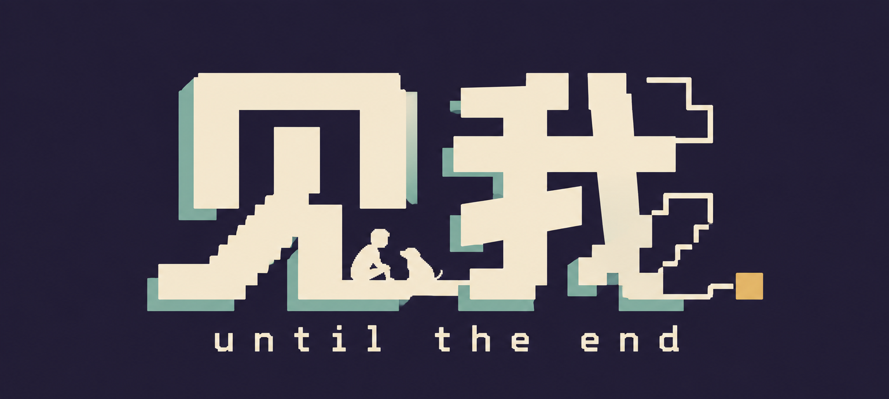
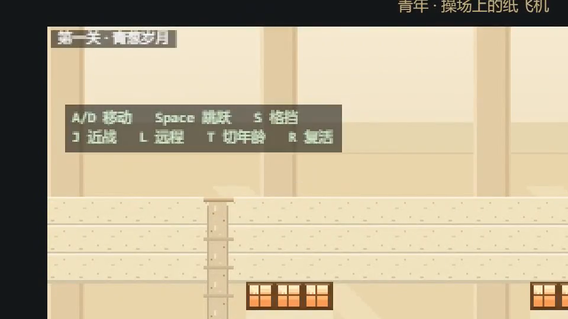
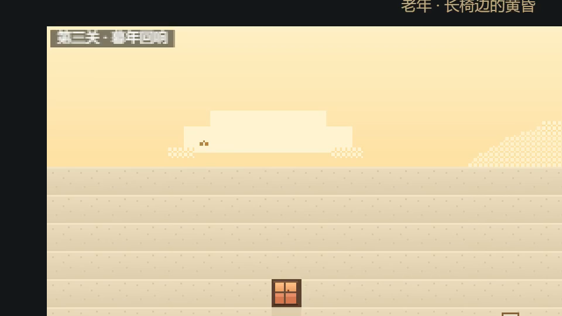

<div align="center">

<picture>
  <source media="(prefers-color-scheme: dark)" srcset="docs/brand/wordmark-dark.png">
  <source media="(prefers-color-scheme: light)" srcset="docs/brand/wordmark-light.png">
  
</picture>

**一场从少年打到暮年的 2D 像素动作闯关。**

[**▶ 立即试玩**](https://kumu314.github.io/UNTIL-THE-END/)　·　[设计文档](游戏功能设计文档.md)　·　[协作规范](CONTRIBUTING.md)


</div>

---

## 关于这款游戏

《见我》是一款**纯 2D 像素风的叙事动作横板闯关游戏**。玩家将陪主角走完三段人生——而人生的每一步代价，都写在你的属性条上。

| 关卡 | 人生阶段 | 生命 | 能量 | 回能 | 跳跃 |
|---|---|:---:|:---:|:---:|:---:|
| 一 · 青葱破茧之夏 | 青年 | 200（厚） | 50（短） | 2/s | ✅ |
| 二 · 泥潭钢筋雨夜 | 中年 | 120（中） | 100（中） | 5/s | ✅ |
| 三 · 暮年回响 | 老年 | 50（脆） | 200（深） | 12/s | ⛔ **永远失去** |

血越来越薄，蓝越来越深，回蓝越来越快——最后连跳跃都被岁月收走。
**当年少的你按下半年的空格、却只听到一声咳嗽时，你会记得自己曾经跳得有多高。**

### 核心亮点

- 🧓 **机制即叙事** —— 老年关剥夺跳跃键：地形改为纯平地推进，战斗从"动作敏捷流"变成"原地记忆法术机关枪"
- 🐕 **忠犬随从** —— 第一关救出的小狗陪你走完三段人生，从幼犬到大黄狗再到老狗，与你一同变老、并肩作战
- 📮 **地图彩蛋** —— 情书、答题卡、保温杯……藏在地图死角里的不是道具，是人生；结局的"人生物品栏"里它们会重新发光
- 👥 **三场 Boss 战** —— 巨影班主任（无尽倒计时）、黄金暴君·老板（画大饼 + 裁员信风暴），以及最终的……
- 🎨 **纯正像素** —— 480×270 逻辑分辨率、`pixelArt` 最近邻采样、16×16 瓦片网格，色盘随年龄推进产生像素级灰度演变

## 截图

| 青年 · 走廊起跑 | 暮年 · 走向孩子 |
|---|---|
|  |  |
| 学会奔跑、跳跃与挥拳 | 接受再也跳不起来 |

> 截图为**受控功能演示**的分关录制帧（非完整通关）。
> 远程弹道随年龄变化：**青年粉笔 → 中年纸飞机 → 老年漫天记忆碎片**（`L` 键）。本图是青年起跑帧，所以画面里没有纸飞机。

## 操作（PC 键盘）

| 按键 | 动作 | 说明 |
|---|---|---|
| `A` / `D` | 左右移动 | |
| `Space` | 跳跃 | **老年期失效**：仅触发驻足咳嗽 |
| `S` | 下蹲格挡 | 减伤 70%；完美格挡 90% 并瞬间回能 10 |
| `J` | 近战三连击 | 0 消耗；老年期为拐杖点地（带定身硬直） |
| `L` | 远程攻击 | 消耗能量：粉笔 → 纸飞机 → 漫天记忆碎片 |
| `Space`+`J` | 空中飞踢 | 对空核心，老年期不可用 |
| `Space`+`L` | 空中投掷 | 消耗能量，老年期不可用 |
| `T` / `R` | 切换年龄 / 复活 | 演示用调试键 |

## 快速开始

> 要求 Node 20+。所有命令**在 `game/` 目录内执行**。

```bash
cd game
npm ci
npm run dev      # 开发服务器 http://localhost:5173（支持局域网联调）
npm test         # 纯逻辑单测（数值曲线 / 战斗判定 / 系统护栏）
npm run build    # 纯静态导出到 game/dist
```

**断网现场兜底**：仓库自带零依赖演示入口（`docs/demo/`），无需 Vite、不引用 CDN：

```bash
cd game && npm ci && npm run build && cd ..
npx serve .      # http://localhost:3000/docs/demo/
```

## 技术栈

| 层 | 选型 |
|---|---|
| 引擎 | Phaser 3.90 · Arcade Physics |
| 构建 | Vite 5 · ES6 模块化 · Vitest |
| 渲染 | `pixelArt: true` 最近邻采样 · 整数倍点对点缩放 |
| 规格 | 角色/敌人 16×16~24×24 · Boss 48×48+ · Tilemap 16×16 |
| 部署 | GitHub Pages（`main` 变动自动构建部署） |

## 项目结构

```
├── docs/                    # 设计文档、协作规范、品牌资产
└── game/                    # Phaser 工程（Vite 根）
    ├── public/assets/       # 静态资源免编译专区
    │   ├── sprites/         # 角色 / 小怪 / 忠犬 / Boss 精灵图（成员 A）
    │   ├── tilesets/        # 三关瓦片 + Tiled 数据 + 彩蛋物件（成员 B）
    │   └── audio/           # 三关原创配乐 + 32 组音效（成员 E）
    ├── tests/               # 纯逻辑单测（全员）
    └── src/
        ├── config/          # 数值、按键、三关地形与布阵
        ├── core/            # 输入层（成员 C）
        ├── entities/        # Player、飞行道具、战斗数值（成员 C）
        ├── ai/              # 小怪 FSM、忠犬、Boss（成员 D）
        ├── ui/              # 战斗 HUD、彩蛋弹窗、转场（成员 E）
        └── scenes/          # Boot / 关卡场景 / 结局（全员协作）
```

## 团队

| 代号 | 角色 | 分支前缀 |
|:---:|---|---|
| **A** | 美术总监 · 角色与随从动效 | `assets/member-A-char-` |
| **B** | 场景关卡美术 · 瓦片设计 | `assets/member-B-env-` |
| **C** | 核心主程 · 角色控制与物理 | `feat/member-C-player-` |
| **D** | 系统架构 · 敌人与忠犬 AI | `feat/member-D-ai-` |
| **E** | UI 交互 · 音频与转场 | `feat/member-E-ui-` |

成员：李姝怡、贾明杰、邓宜安、赵紫阳、任涵毓

## 协作

**双主干 + 按功能短命分支 + 强制 PR。** 功能 PR 目标 `develop`（CI 绿 + 自查），合并权集中由成员 A 批量执行；`develop` 阶段性整体测试通过后晋升 `main`，`main` 变动自动部署 Pages。

- **[CONTRIBUTING.md](CONTRIBUTING.md)** —— PR 规矩与红线
- **[开发分工与GitHub协作规范](开发分工与GitHub协作规范.md)** —— 分工与目录树
- **[游戏功能设计文档](游戏功能设计文档.md)** —— GDD 全案

## 当前状态

- [x] 立项与 GDD（关卡 / 敌人 / 彩蛋 / Boss / 结局全案）
- [x] 工程脚手架（Phaser 3.90 + Vite 5 + Vitest + CI 门禁）
- [x] 主角控制器与三阶段机能演变（老年禁跳 / 检查点复活）
- [x] **三关全部可玩**：地形 / 彩蛋 / 双 Boss / 忠犬协战
- [x] 原创配乐与 32 组音效（声音设置持久化）
- [x] 结局：拥抱终局 + 像素大合照
- [x] 在线试玩（GitHub Pages，随主干自动部署）
- [x] 数值平衡真人验收 · 试玩遥测基础设施在线
- [x] 宣传片初剪（60s · 受控演示录制素材）
- [x] 结局五幕漫画（P2，已完成）

## License

[MIT](LICENSE)
