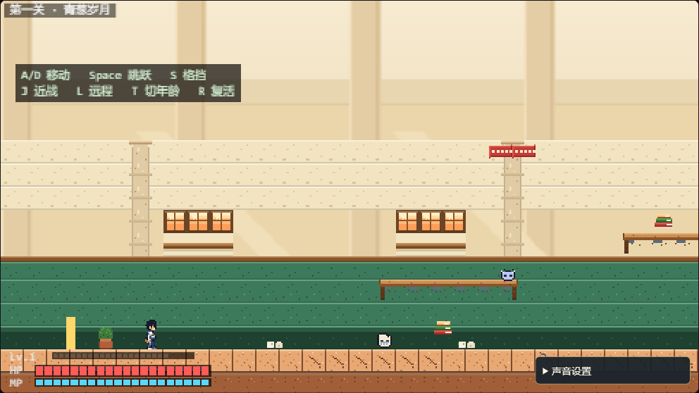

# 《见我》 Until the End

> 一场关于成长、挣扎、衰老与遗忘的 2D 像素动作闯关。
> HENU Hackathon 参赛作品 · Phaser 3 + Vite

## ▶ 在线试玩

**<https://kumu314.github.io/UNTIL-THE-END/>**

键盘操作：`A/D` 移动 · `Space` 跳跃（暮年关失效）· `S` 格挡 · `J` 近战 · `L` 远程 · `T` 切换年龄（演示）· `R` 复活

---

## 这是一款什么游戏

《见我》是一款**纯 2D 像素风的叙事动作横板闯关游戏**。玩家将陪主角走完三段人生——而人生的每一步代价，都写在你的属性条上：

| 关卡 | 人生阶段 | 生命值 | 能量上限 | 回能 | 跳跃 |
|---|---|:---:|:---:|:---:|:---:|
| 第一关 · 青葱破茧之夏 | 青年 | 200（厚） | 50（短） | 2/s（慢） | ✅ |
| 第二关 · 泥潭钢筋雨夜 | 中年 | 120（中） | 100（中） | 5/s（稳） | ✅ |
| 第三关 · 暮年回响 | 老年 | 50（脆） | 200（深） | 12/s（极快） | ⛔ **永远失去** |

血越来越薄，蓝越来越深，回蓝越来越快——最后连跳跃都被岁月收走。
**当年少的你按下半年空格、却只听到一声咳嗽时，你会记得自己曾经跳得有多高。**

### 核心亮点

- 🧓 **机制即叙事** —— 老年关剥夺跳跃键：地形全部改为纯平地推进，战斗从"动作敏捷流"变成"原地记忆法术机关枪"
- 🐕 **忠犬随从** —— 第一关救出的小狗会陪伴你走完三段人生，从幼犬到大黄狗再到老狗，与你一同变老、并肩作战
- 📮 **地图彩蛋** —— 情书、答题卡、保温杯……藏在地图死角里的不是道具，是人生。每件收藏都会在结局的"人生物品栏"里发光
- 👥 **三场 Boss 战** —— 巨影班主任（无尽倒计时）、黄金暴君·老板（画大饼+裁员信风暴）、以及最终的……
- 🎨 **纯正像素** —— 480×270 逻辑分辨率（FIT 整体缩放，`pixelArt` 最近邻采样），16×16/24×24 精灵网格，色盘随年龄推进产生像素级灰度演变

## 立即体验

**在线演示**：公网地址尚未部署（部署后在此补齐）。**离线一键演示**：仓库自带一个零依赖落地页，
不需要 Vite、不引用任何 CDN，断网也能开：

```bash
cd game
npm ci
npm run dev      # 开发模式：http://localhost:5173
```

要在评审现场"点一个按钮就进游戏"，用仓库内的演示入口（需先构建一次）：

```bash
cd game && npm ci && npm run build && cd ..
npx serve .      # 浏览器打开 http://localhost:3000/docs/demo/
```



> 演示页细节与排错见 [docs/demo/README.md](docs/demo/README.md)。

## 操作（PC 键盘）

| 按键 | 动作 | 说明 |
|---|---|---|
| `A` / `D` | 左右移动 | |
| `Space` | 跳跃 | **老年期失效**：仅触发驻足咳嗽 |
| `S` | 下蹲格挡 | 减伤 70%；完美格挡 90% 并瞬间回能 10 |
| `J` | 近战三连击 | 0 消耗；老年期为拐杖点地（带定身硬直） |
| `L` | 远程攻击 | 消耗能量：粉笔 → 纸飞机 → 漫天记忆碎片 |
| `Space`+`J` | 空中飞踢 | 对空核心，老年期不可用 |
| `Space`+`L` | 空中投掷 | 消耗能量，老年期不可用 |

## 技术栈

- **引擎**：Phaser 3（v3.80+）· Arcade Physics 内置物理
- **构建**：Vite 5 · ES6 模块化（`npm run dev` 局域网联调 / `npm run build` 纯静态导出）
- **渲染**：`pixelArt: true` 全局禁用平滑，Point 采样点对点缩放
- **规格**：角色/敌人 16×16~24×24，Boss 48×48+，Tilemap 16×16

## 快速开始

> 脚手架由成员 C 提供（PR #7），以下命令**在 `game/` 目录内执行**：

```bash
cd game
npm install
npm run dev      # 开发服务器 http://localhost:5173（已开 --host，支持局域网联调）
npm run test     # 纯逻辑单测（数值曲线 / 战斗判定 / 输入语义）
npm run build    # 产出纯静态文件到 game/dist
```

## 项目结构

```
├── docs/                   # 设计文档与协作规范（GDD / 分工 / 评审）
└── game/                   # Phaser 工程（Vite 根，路径约定见分工规范 §4）
    ├── index.html          # Canvas 挂载根节点
    ├── package.json        # phaser ^3.90 / vite ^5 / vitest ^2
    ├── vite.config.js      # Vite 构建与 dev server
    ├── public/assets/      # 静态资源免编译专区
    │   ├── sprites/        # 角色/小怪/忠犬/Boss 精灵图（成员 A）
    │   ├── tilesets/       # 瓦片集 + Tiled 关卡数据 + 彩蛋物件（成员 B）
    │   └── audio/          # 8-bit 音效与 BGM（成员 E）
    ├── tests/              # 纯逻辑单测（成员 C，与其他模块按需扩展）
    └── src/
        ├── main.js         # Phaser.Game 初始化入口
        ├── config/         # 关卡数值、按键常量、三关地形数据
        ├── core/           # 输入层（成员 C）
        ├── entities/       # Player、飞行道具、战斗数值（成员 C）
        ├── ai/             # 小怪 FSM、忠犬、Boss（成员 D）
        ├── ui/             # 战斗 HUD、彩蛋弹窗（成员 E）
        └── scenes/         # Boot + 关卡场景（全员协作）
```

以上路径均相对于 `game/`。静态资源放 `game/public/assets/`（`sprites/` 成员A · `tilesets/` 成员B · `audio/` 成员E），Vite 会原样拷贝到 `game/dist/assets/` 并可被浏览器直接访问。

## 团队

| 代号 | 角色 | 专属分支前缀 |
|:---:|---|---|
| **A** | 美术总监 / 角色与随从动效 | `assets/member-A-char-` |
| **B** | 场景关卡美术 / 瓦片设计 | `assets/member-B-env-` |
| **C** | 核心主程 / 角色控制器与物理 | `feat/member-C-player-` |
| **D** | 系统架构 / 敌人与忠犬 AI | `feat/member-D-ai-` |
| **E** | UI 交互 / 音频与转场 | `feat/member-E-ui-` |

成员：李姝怡、贾明杰、邓宜安、赵紫阳、任涵毓

## 协作指南

**双主干 + 按功能短命分支 + 强制 PR**：

```
main（发布：可演示、无报错） ◀── 技术负责人阶段性合并
 ▲
develop（集成：全员联调目标） ◀── 所有功能 PR 提到这里（≥1 人互审）
 ▲
 assets/member-A-char-* · assets/member-B-env-* · feat/member-C-player-*
 feat/member-D-ai-* · feat/member-E-ui-*        （Squash 合并后即删）
```

- 提 PR 前必读 **[CONTRIBUTING.md](CONTRIBUTING.md)**（PR 规矩、红线、应急条款）
- 分工与验收标准见 **[开发分工与GitHub协作规范](开发分工与GitHub协作规范.md)**
- 游戏设计规格见 **[游戏功能设计文档](游戏功能设计文档.md)**

## 当前状态

- [x] 立项与 GDD（含关卡/敌人/彩蛋/Boss/结局全案）
- [x] 技术栈锁定与工程脚手架（Phaser 3.90 + Vite 5，`pixelArt` 像素渲染基线）
- [x] 五人分工与协作规范、双主干治理（main/develop 均有分支保护）
- [x] 主角控制器与三阶段机能演变（含老年禁跳、检查点复活）
- [x] **三关全部可玩**：地形/彩蛋/检查点/双 Boss/忠犬协战/需求变更涡流反弹
- [x] 三关原创配乐 + 32 组音效（声音设置持久化）
- [x] 结局：拥抱终局 + 像素大合照（黑屏打字机保底先行，动画版待时间富余）
- [x] GitHub Pages 在线试玩入口
- [ ] 数值平衡 pass（试玩遥测已就绪：跑完一局控制台 `__fmnTelemetry.download()` 导数据）
- [ ] 全流程宣传片

## License

本项目采用 MIT 许可证，详见 [LICENSE](LICENSE)。
