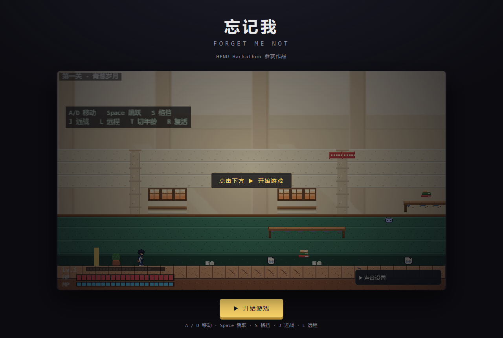
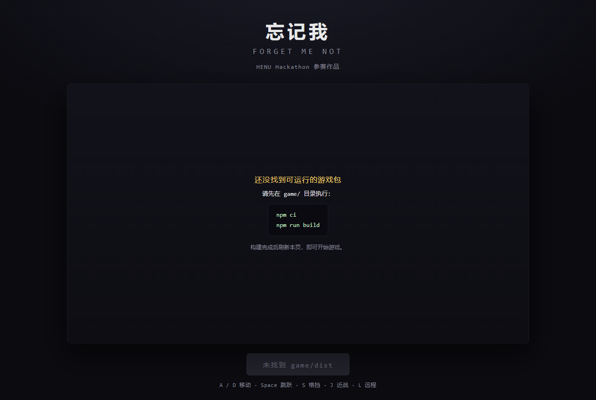

# 演示入口（docs/demo）

一个**零依赖、纯静态**的落地页，用来在评审现场或线上直接打开游戏。
不依赖 Vite 开发服务器，不引用任何外部 CDN（断网也能用）。

## 三步启动

```bash
# 1. 构建游戏（只需一次；产物在 game/dist，已被 .gitignore 忽略）
cd game && npm ci && npm run build

# 2. 在仓库根目录起一个静态服务器
cd .. && npx serve .

# 3. 浏览器打开
#    http://localhost:3000/docs/demo/
```

第 2 步的 `cd ..` 是从 `game/` 回到仓库根目录。

## 为什么必须在仓库根目录起服务

页面用相对路径 `../../game/dist/index.html` 找产物，只有把**仓库根目录**当站点根时才成立：

```
<站点根>/docs/demo/index.html      ← 演示页
<站点根>/game/dist/index.html      ← 构建产物（iframe 目标）
```

如果只把 `game/dist` 起成服务器，`docs/demo/` 就不在站点里了，打不开演示页。

## 页面预览

| 就绪态（海报 + 开始按钮） | 未构建态（人话提示，不是白屏） |
|---|---|
|  |  |

`screenshot.png` 是 README 里引用的游戏画面，也是本页海报层的底图。

## 三种状态

| 现象 | 含义 | 处理 |
|---|---|---|
| 按钮显示「▶ 开始游戏」 | 已检测到 `game/dist`，可以点了 | 点击即可 |
| 按钮显示「未找到 game/dist」+ 提示文案 | 产物没构建，或路径不对 | 按页面提示执行 `cd game && npm ci && npm run build` |
| 提示「当前是用 file:// 直接打开的」 | 双击了 html 文件 | 改用静态服务器（见上），`file://` 会拦截模块与 fetch |

## 几个已知细节

- **键盘要先拿焦点**：点击「开始游戏」后脚本会 `iframe.contentWindow.focus()`；
  若发现 `A/D` 没反应，用鼠标点一下画面即可。
- **声音要一次手势**：浏览器自动播放策略要求首次点击/按键后才出声，这是正常现象。
- **`npx serve` 端口**：默认 3000，被占用会顺延，以终端输出为准。
  也可以用 `python -m http.server 8000` 代替。
- **不要双击打开 `docs/demo/index.html`**：`file://` 协议下浏览器会拦截 ES module 与 `fetch`，
  页面会直接落到提示态——这是设计好的降级，不是 bug。

## 想部署到 GitHub Pages

把 Pages 的根目录指向仓库（或构建后把 `game/dist` 作为 `/game/dist` 一起发布），
演示页地址就是 `https://<用户>.github.io/<仓库>/docs/demo/`。
`vite.config.js` 里 `base: './'` 已是相对路径，无需额外配置。
